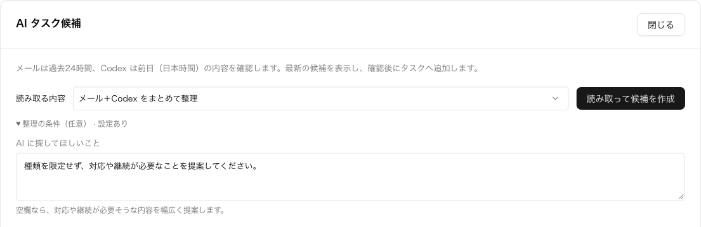
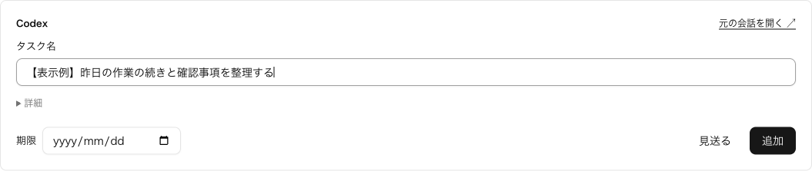
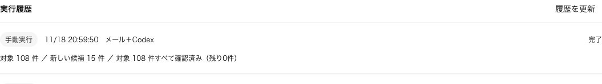
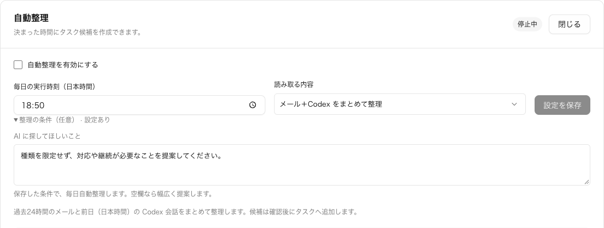

# 2026/11/18｜定時整理・Codex連携・全量タスク提案

[進捗一覧に戻る](https://bizmates.atlassian.net/wiki/spaces/27/pages/4748869670) ｜ [Confluence で開く](https://bizmates.atlassian.net/wiki/spaces/27/pages/4871061561) ｜ [GitHub](https://github.com/Kaedeeeeeeeeee/todo-agent)

## やったこと

Codex SDK を使い、過去24時間の Gmail と前日（日本時間）のローカル Codex 会話から、対応や継続が必要な内容をまとめて提案できるようにした。メールの種類や送信者を固定せず、ユーザーが整理条件を編集できる。

[今回の実装（0931f35）](https://github.com/Kaedeeeeeeeeee/todo-agent/commit/0931f35c47e33992eca5cb0b3650efa2eb132cf0)

以下はローカル環境の画面例。候補名は表示用に変更した未保存の入力で、個人メールアドレス・メール本文・会話内容は掲載していない。

### 全量整理と条件のカスタマイズ

メールのみ・Codex 会話のみ・両方の一括整理を選べる。「整理の条件」に探してほしい内容を自由に入力でき、空欄なら対応や継続が必要そうな内容を幅広く提案する。Gmail は過去24時間の本文（迷惑メール・ゴミ箱を除く）、Codex は前日0時～24時の会話内の依頼を対象とする。

### Codex 会話からの候補と、シンプルな確認画面

Codex 由来の候補にも元の会話へのリンクを付けた。候補カードにはタスク名・期限・操作を中心に表示し、説明や提案の根拠は「詳細」にまとめた。読み取り中も保存済みの候補を確認・修正できる。候補一覧は読み取り元ごとの最新実行だけを表示し、過去のデータは保存する。

### 全件を分割処理し、進捗と結果を保存

対象を全件列挙してから分割処理し、進捗・実行履歴・失敗時の再試行に対応した。今回の実データではメール95件と Codex の依頼13件、合計108件をすべて確認し、15件の候補を作成した。候補の現在の対応状況と期限はユーザーが確認し、採用したものだけを正式なタスクへ追加する。

### 毎日の定時整理にも同じ条件を設定

毎日の実行時刻（日本時間）・読み取り元・整理の条件を保存できる。バックグラウンド処理が動いていれば、ページを閉じても分割処理を継続する。画面例では定時整理を停止している。

## 来週にやること

- 未完了タスクへの進捗確認を追加し、AI の質問に返信して進捗メモへ保存する流れを実装する。
- 実データを使って提案内容を見直し、同じ作業に関する類似候補の整理を改善する。
